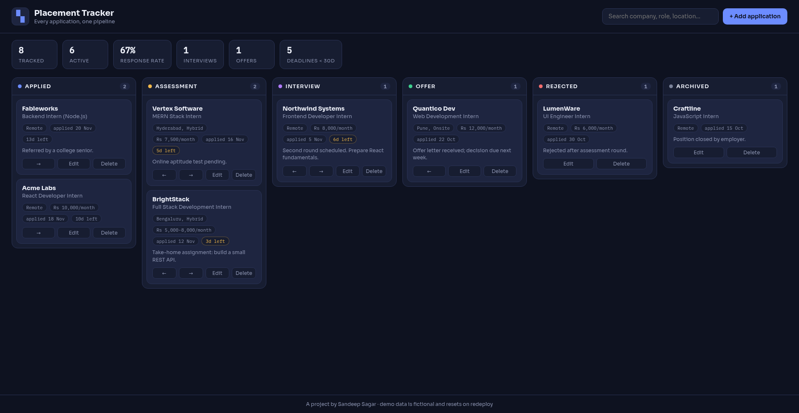
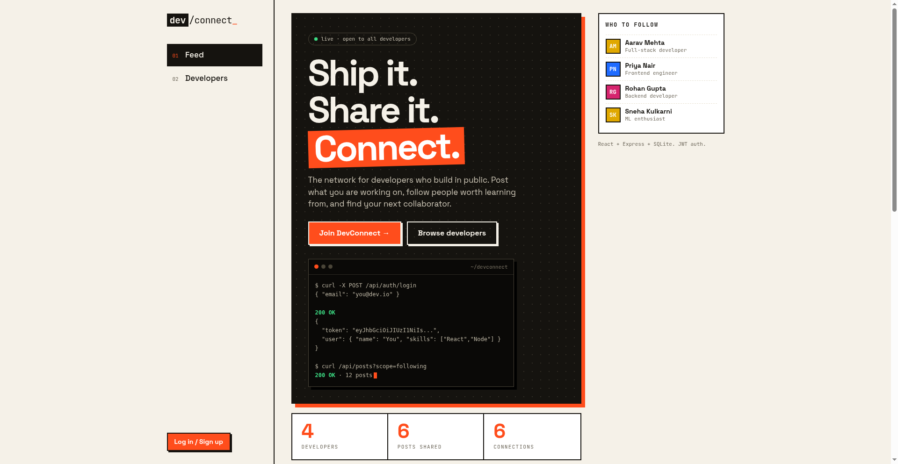
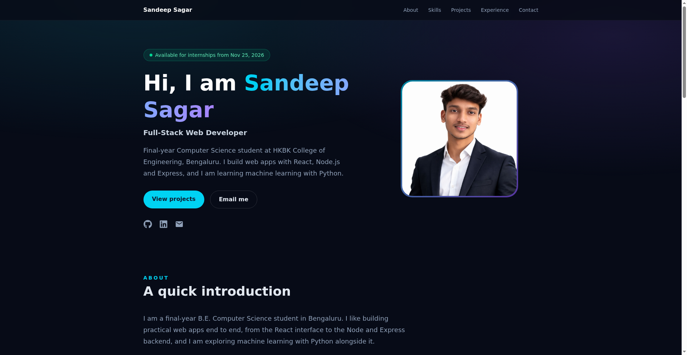
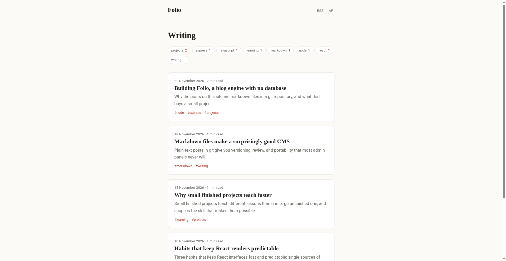
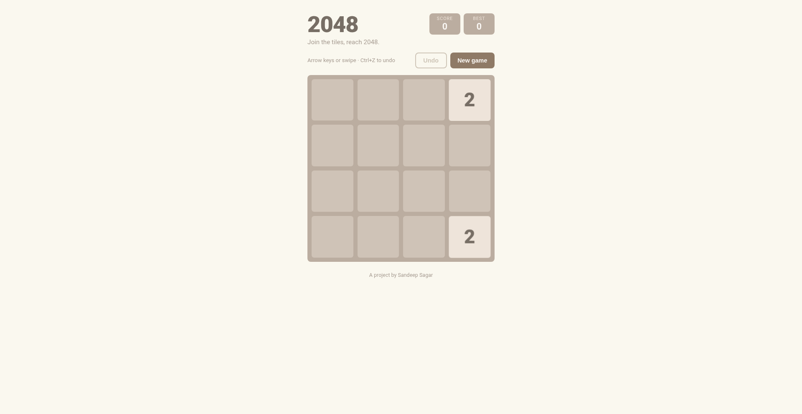
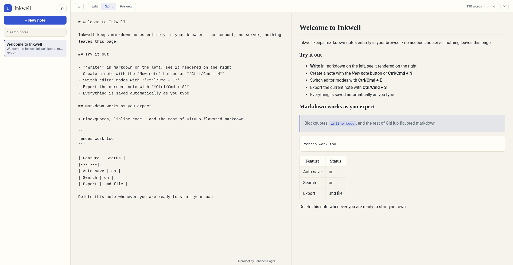
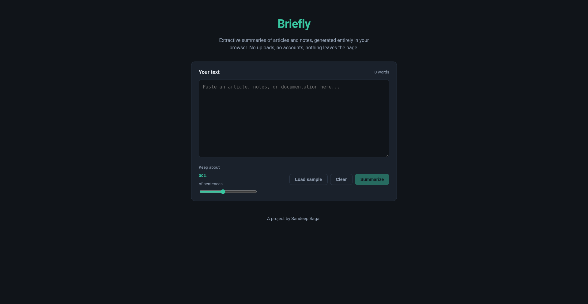
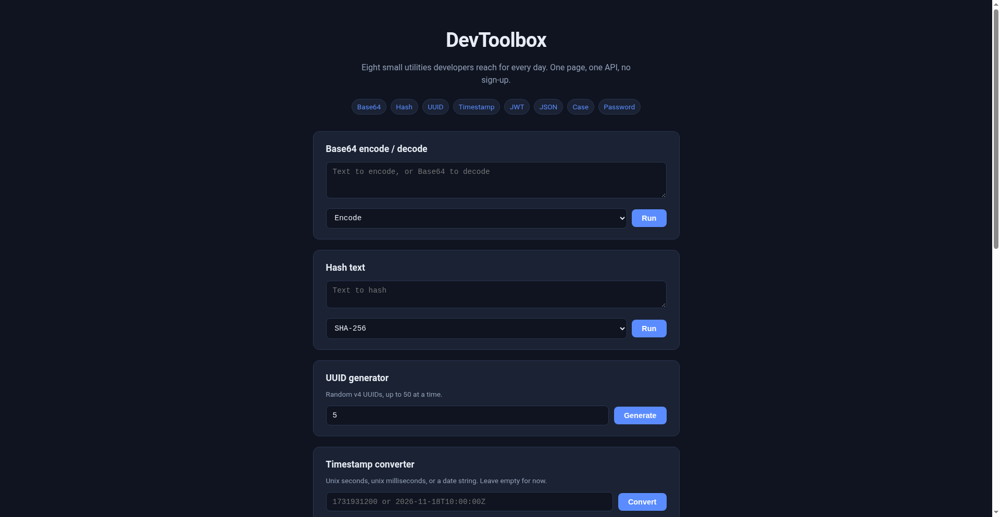
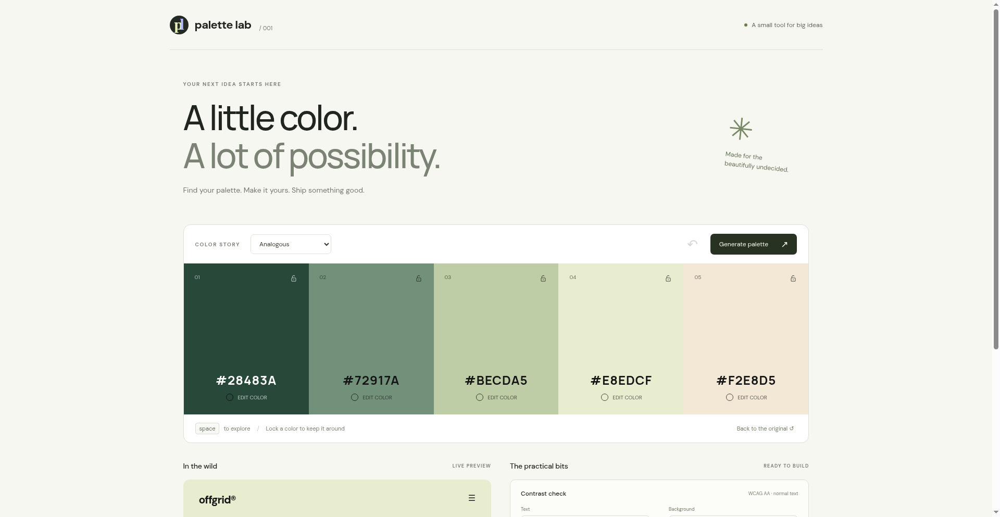

  

Final-year Computer Science and Engineering student at HKBK College of Engineering, Bengaluru. 
I build and ship software end to end: **full-stack web applications** and **machine-learning models in Python**. 
Open to internships and entry-level roles.

<a href="#about">About</a> · <a href="#web-projects">Full-Stack Projects</a> · <a href="#aiml-projects">AI/ML Projects</a> · <a href="#experience">Experience</a> · <a href="#stats">Stats</a>

# 💫 About Me:

🎋 I'm currently working on **Placement Tracker - a full-stack internship & job application tracker** 
👯 I'm looking to collaborate on **full-stack web apps and AI/ML projects** 
🌱 I'm currently learning **AI/ML engineering - model training and evaluation** 
💬 Ask me about **full-stack development, machine learning, or anything I have shipped** 
⚡ Fun fact **Most of my projects have live demos you can try right now**

## 🌐 Socials:

# 💻 Tech Stack:

**Languages**

**Frontend**

**Backend & Databases**

**AI / Machine Learning**

**Tools & Platforms**

---

## 🌐 Full-Stack & Web Projects

| Preview | Project |
| --- | --- |
|  | 📌 **Placement Tracker** Track internship & job applications end to end: kanban pipeline with drag and drop, stage history, deadline badges, stats dashboard. 20 automated tests gate every deploy.  `Node.js` `Express` `PostgreSQL`    |
|  | 🧑‍💻 **DevConnect** A community app for developers: sign up and log in, profiles with skills, a post feed, follow other developers, search.  `React` `Node/Express` `SQLite` `JWT`    |
|  | 🎨 **Portfolio** My personal portfolio site.  `React` `Vite` `Tailwind CSS` `Framer Motion`    |
|  | ✒️ **Folio** File-based markdown blog engine: server-rendered pages, tags, RSS feed, JSON API.  `Node.js` `Express`    |
|  | 🎮 **2048** The classic game with smooth animations, undo, best-score saving, keyboard and touch.  `React`    |
|  | 📝 **Inkwell** Markdown notes entirely in the browser: live preview, auto-save, search, export, themes.  `React` `Vite`    |
|  | ✂️ **Briefly** Extractive text summarizer running fully client-side with dependency-free sentence scoring.  `React` `Vite`    |
|  | 🧰 **DevToolbox** Developer utility API and web UI: Base64, hashes, UUIDs, JWT decoding, JSON formatting and more.  `Node.js` `Express`    |
|  | 🎨 **Palette Lab** Color studio: palette generation, live previews, contrast checks, CSS export.  `HTML` `CSS` `JavaScript`    |

The demos run on free hosts, so the first load can take about a minute.

## 🤖 AI / Machine Learning Projects

| Project | What it is | Code |
| --- | --- | --- |
| ✍️ **Handwritten Digit Recognizer** | Recognizes handwritten digits (0-9) with a CNN trained on MNIST. |  |
| 🎬 **Movie Recommendation System** | Content-based recommender using genre similarity, TF-IDF and cosine similarity. |  |

---

## 💼 Experience

- **Artificial Intelligence Intern**, CODEC Technologies
- **Web Development Intern**, Prodigy InfoTech (March 2026, one month)

---

# 📊 GitHub Stats:

  
  
   
  

---

  
   
  

